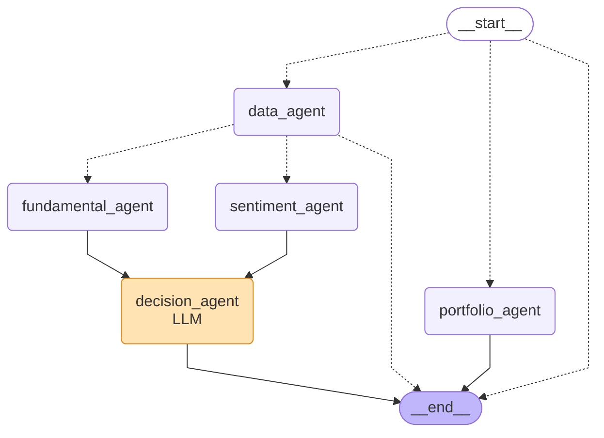

# trade-compass

[](https://github.com/PCBZ/trade-compass/actions/workflows/ci.yml)
[](https://www.python.org/)
[](https://langchain-ai.github.io/langgraph/)
[](https://fastapi.tiangolo.com/)
[](https://core.telegram.org/bots)
[](https://www.mongodb.com/atlas)
[](https://www.terraform.io/)
[](https://cloud.google.com/run)
[](LICENSE)

A personal US-equity research assistant. It syncs your Moomoo/Futu positions, runs them
through a LangGraph multi-agent pipeline, and delivers **BUY / HOLD / SELL** verdicts with
reasoning — straight to Telegram.

> **It does not place orders.** trade-compass is read-only against your brokerage: it
> fetches positions and produces analysis. Every trade stays a manual decision.
> Nothing here is investment advice.

**Documentation lives in the [wiki](https://github.com/PCBZ/trade-compass/wiki)** —
architecture, how the pipeline and the LLM layer work, operations and a runbook. This
README is the quick start.

---

## What it is

Three deployable units, one database, all infrastructure in Terraform:

| Unit | Runs on | Responsibility |
|------|---------|----------------|
| [`bot/`](bot/) | Cloud Run | LangGraph agents, Telegram webhook, scheduled pushes |
| [`api/`](api/) | Cloud Run | FastAPI data layer over MongoDB (holdings, quotes, preferences, cache) |
| [`sync/`](sync/) | Compute Engine | Moomoo OpenD client; cron-driven position and quote push |

See [Architecture](https://github.com/PCBZ/trade-compass/wiki/Architecture) for the
diagram and data flow.

## How the analysis works

<!-- generated by bot/scripts/draw_graph.py — do not edit by hand -->


The orange node calls an LLM; the purple ones are plain Python. Only `decision_agent`
does, so one analysis costs one LLM call. Scores (Piotroski, Altman-Z) are computed from
SEC filings, not inferred by the model. Details and the reasoning behind these choices
are in [Analysis pipeline](https://github.com/PCBZ/trade-compass/wiki/Analysis-pipeline).
Regenerate the diagram with `python bot/scripts/draw_graph.py --write`.

## Telegram commands

| Command | Effect |
|---------|--------|
| `/decide TICKER` | Full analysis of one stock |
| `/portfolio` | Analyse every STOCK holding + concentration risk |
| `/model` | Inline keyboard to switch the analysis LLM |
| `/help`, `/start` | Command list |

Cloud Scheduler also triggers a portfolio sweep five times each weekday and sends it to
your chat; see
[Telegram commands and REST API](https://github.com/PCBZ/trade-compass/wiki/Telegram-commands-and-REST-API)
for the schedule and the API routes.

---

## Deployment

### Prerequisites

- A GCP project with billing enabled, plus `gcloud` and `terraform` on your machine
- A MongoDB Atlas account with an org ID and API key pair
- A Moomoo/Futu account with US market data (OpenD needs real credentials)
- API keys: [Telegram BotFather](https://t.me/botfather),
  [Financial Modeling Prep](https://site.financialmodelingprep.com/),
  [Gemini API](https://aistudio.google.com/apikey)
- A contact email for `SEC_CONTACT`. SEC EDGAR and the Nasdaq RSS feed need no key,
  but EDGAR rejects any request whose User-Agent carries no email address

### 1. Configure

```bash
cp .env.example .env   # set GCP_PROJECT_ID
```

Copy each `terraform.tfvars.example` to `terraform.tfvars` and fill in the values —
Atlas needs `atlas_public_key`, `atlas_private_key`, `atlas_org_id`, and `db_password`;
Compute Engine needs `ssh_allowed_ips`.

Put your own keys in `bot/.env` (`cp bot/.env.example bot/.env`). The deploy script
fills in `API_URL` and `API_KEY` for you and preserves anything already set, but
`FMP_API_KEY`, `GEMINI_API_KEY`, `TELEGRAM_BOT_TOKEN`, and `TELEGRAM_CHAT_ID` are
yours to supply. Get your chat ID by messaging [@userinfobot](https://t.me/userinfobot).
The full variable list is in
[Configuration](https://github.com/PCBZ/trade-compass/wiki/Configuration).

### 2. Deploy

```bash
cd terraform && ./deploy.sh
```

Eight ordered steps: tfstate bucket → VM (static IP first, so Atlas can allowlist it) →
Atlas cluster → API on Cloud Run → write `bot/.env` → VM again with the resolved
`api_url` → bot on Cloud Run → register the Telegram webhook. Cloud Run URLs and the
generated API key are printed at the end.

This is a one-time provision. After it, pushing a `v*` tag runs `terraform apply` via
GitHub Actions; merging to `main` does not deploy. See
[`docs/DEPLOY.md`](docs/DEPLOY.md) for the CI/CD setup and
[Deployment and releases](https://github.com/PCBZ/trade-compass/wiki/Deployment-and-releases)
for how it works. The VM and Atlas stay with `deploy.sh` by hand.

### 3. Finish the VM by hand

OpenD needs interactive credentials, so the VM bootstrap stops short of starting it:

```bash
gcloud compute ssh trade-compass --zone us-west1-b
```

Then on the VM, edit `OpenD.xml` with your Moomoo login (the bootstrap log prints the
exact path), and:

```bash
sudo systemctl start moomoo-opend && sudo bash /opt/trade-compass/sync/setup_cron.sh
```

Cron then runs the sync every 5 minutes, 13:30–20:00 UTC, Mon–Fri, pushing both
positions and an OpenD price snapshot. Logs land in `/var/log/trade-compass-sync.log`.

**Do not skip `setup_cron.sh`.** The bootstrap never installs it, and nothing else
will: without it holdings sit frozen at whatever was last pushed. Re-check
`sudo crontab -l` after any VM recreate. More in the
[Runbook](https://github.com/PCBZ/trade-compass/wiki/Runbook).

---

## Local development

Each unit has its own requirements file and its own virtualenv.

```bash
python -m venv api/.venv && api/.venv/bin/pip install -r api/requirements-dev.txt
python -m venv bot/.venv && bot/.venv/bin/pip install -r bot/requirements-dev.txt -r bot/requirements.txt
```

Run the API against a local or Atlas MongoDB:

```bash
cd api && API_KEY=dev MONGODB_URI=mongodb://localhost:27017 uvicorn src.main:app --reload
```

Run the bot (needs `bot/.env` populated, including `SEC_CONTACT`):

```bash
cd bot && uvicorn src.main:app --reload --port 8081
```

Telegram delivers updates by webhook, so for local bot testing either expose port 8081
through a tunnel and re-register the webhook, or POST an update payload to `/webhook`
directly.

### Tests

```bash
cd api && pytest tests/ -v
cd bot && pytest tests/unit -v --cov=src --cov-report=term-missing
```

Both suites run in CI with no network and no LLM call. The `bot/tests/test_*.py` files
are **live integration tests** (real FMP, Gemini and REST APIs, a populated `bot/.env`),
so CI skips them; run them by hand when you change a data source, for example
`python -m pytest bot/tests/test_fmp.py -v`.

[`ci.yml`](.github/workflows/ci.yml) runs on every push and pull request to `main`:
lint, both unit suites, `terraform fmt` and `validate`, and ShellCheck.

---

## Things to know

- **FMP's free tier serves only a fixed allowlist of symbols.** A restricted symbol is
  still analysed, but loses the FMP-only ratios.
- **Nothing alerts when the sync stops.** If the VM's cron is missing, holdings go stale
  silently; check `sudo crontab -l` and the sync log first.
- **The API is public with key-only auth.** `X-API-Key` is the only barrier on the data
  layer; `/webhook` and `/push` are unauthenticated.
- **Gemini free-tier prompts may be used by Google to improve its products**, and they
  contain your positions.
- **A from-scratch `deploy.sh` currently stops at step 1**; run the first bootstrap
  apply by hand as [`docs/DEPLOY.md`](docs/DEPLOY.md#bootstrap-state) describes.

The rest, with the reasoning, is in
[Known limits](https://github.com/PCBZ/trade-compass/wiki/Known-limits).

## License

Apache 2.0 — see [LICENSE](LICENSE).

[DESIGN.md](DESIGN.md) and the wiki's
[Proposal](https://github.com/PCBZ/trade-compass/wiki/Proposal) are the original design,
written before the current data sources and pipeline; where they disagree with this README
or the wiki, those are right.
