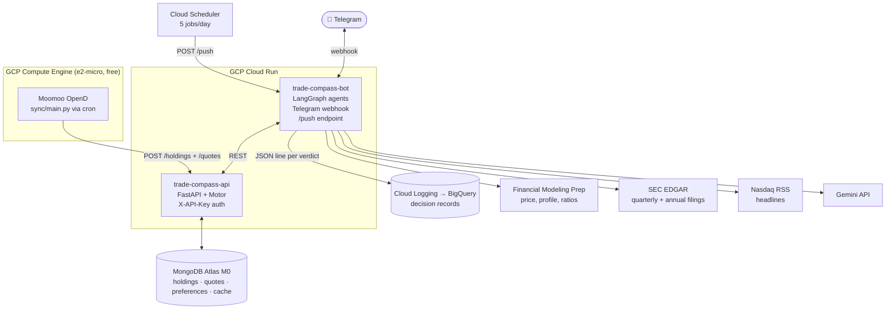
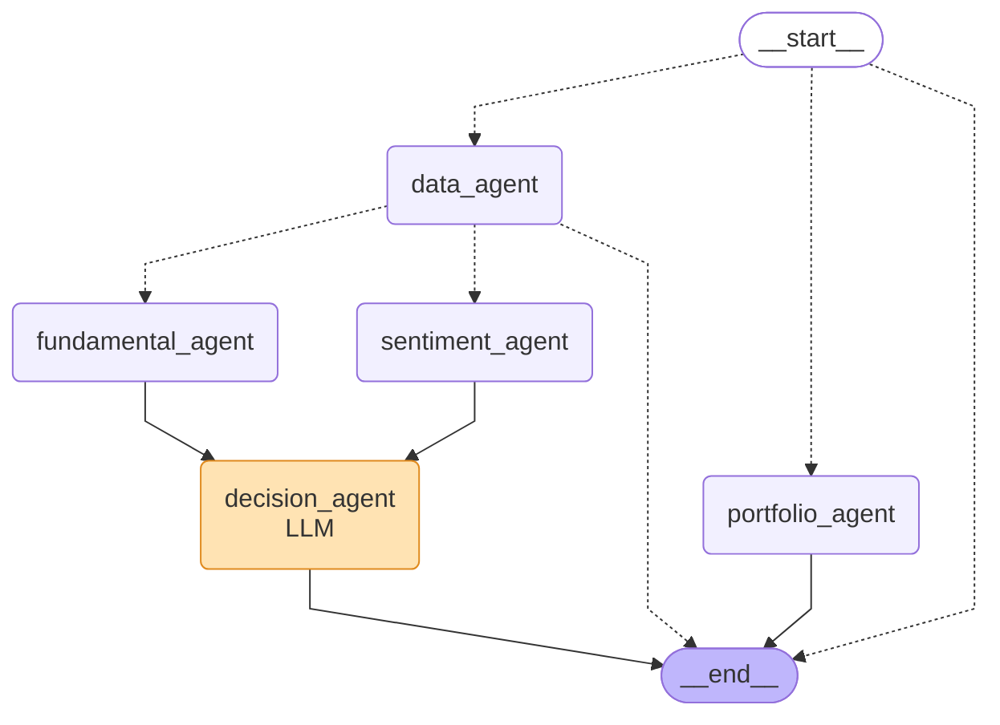

# trade-compass

[](https://github.com/PCBZ/trade-compass/actions/workflows/ci.yml)
[](https://www.python.org/)
[](https://langchain-ai.github.io/langgraph/)
[](https://fastapi.tiangolo.com/)
[](https://core.telegram.org/bots)
[](https://www.mongodb.com/atlas)
[](https://www.terraform.io/)
[](https://cloud.google.com/run)
[](LICENSE)

A personal US-equity research assistant. It syncs your Moomoo/Futu positions, runs them
through a LangGraph multi-agent pipeline, and delivers **BUY / HOLD / SELL** verdicts with
reasoning — straight to Telegram.

> **It does not place orders.** trade-compass is read-only against your brokerage: it
> fetches positions and produces analysis. Every trade stays a manual decision.
> Nothing here is investment advice.

---

## Architecture



Three deployable units, one database:

| Unit | Runs on | Responsibility |
|------|---------|----------------|
| [`bot/`](bot/) | Cloud Run | LangGraph agents, Telegram webhook, scheduled pushes |
| [`api/`](api/) | Cloud Run | FastAPI data layer over MongoDB (holdings, quotes, preferences, cache) |
| [`sync/`](sync/) | Compute Engine | Moomoo OpenD client; cron-driven position and quote push |

All infrastructure is Terraform ([`terraform/`](terraform/)).

---

## How the analysis works

<!-- generated by bot/scripts/draw_graph.py — do not edit by hand -->


The orange node calls an LLM; the purple ones are plain Python.

Dotted arrows are conditional edges: `__start__` goes to `data_agent` when `mode` is
`single` and to `portfolio_agent` otherwise, and either branch short-circuits to
`__end__` if the state carries an error. `portfolio_agent` reaches the four
single-stock nodes by invoking `single_stock_graph` per holding, which is a nested call
rather than an edge — so it does not appear above.

| Node | Kind | Does |
|------|------|------|
| [`data_agent`](bot/src/agents/data.py) | I/O, no LLM | Fetches 8 sources in parallel — 3 FMP endpoints, SEC EDGAR, Nasdaq RSS, and 3 calls to our own API |
| [`fundamental_agent`](bot/src/agents/fundamental.py) | deterministic | Organises valuation, trailing-twelve-month growth and quality ratios; computes Piotroski / Altman-Z |
| [`sentiment_agent`](bot/src/agents/sentiment.py) | deterministic | Organises 52-week position and news headlines |
| [`decision_agent`](bot/src/agents/decision.py) | **LLM** | Synthesises everything into a structured verdict |
| [`portfolio_agent`](bot/src/agents/portfolio.py) | orchestrator, no LLM of its own | Runs the single-stock subgraph per holding — one `decision_agent` call each — then scores concentration |

Two design choices worth knowing:

1. **Only `decision_agent` calls the LLM.** The fundamental and sentiment agents are
   plain Python — they compute derived metrics and shape context. One analysis costs
   one LLM call (more only if a model fails over to the next configured one), and
   `/portfolio` costs one per holding.
2. **Scores are rule-based, not model-inferred.** Piotroski F-Score and Altman Z-Score
   are computed from SEC filings, and the verdict is forced through a Pydantic schema
   via `with_structured_output`. Altman's Z grows without bound for a low-debt
   large-cap, so the prompt shows it capped at `>10` rather than a number that would
   read as extraordinary.
3. **Fundamentals are trailing-twelve-month.** Annual filings alone can be a year
   stale, so quarterly filings are decomposed into TTM figures: Q4 is never filed on
   its own (it is derived from the annual total), cash-flow facts arrive year-to-date
   and are differenced, and share counts are not.

Routing lives in conditional edges ([`graph/workflow.py`](bot/src/graph/workflow.py)),
not in a separate node. Two graphs are compiled over the same agents: `graph` (routes on
`mode`) and `single_stock_graph`, which omits `portfolio_agent` — otherwise
`portfolio_agent` invoking the full graph could route straight back into itself.
Regenerate either topology with `python bot/scripts/draw_graph.py --write`.

### Decision records

Each verdict is also written to stdout as one flat JSON line carrying the full prompt
and the model's response. Cloud Run parses that into a structured log entry, and a log
sink routes it to a BigQuery dataset (`trade_compass_eval`) defined in
[`terraform/bot/`](terraform/bot/main.tf). The point is a corpus for evaluating the
LLM step: the inputs — price, headlines, TTM figures at that moment — cannot be
reconstructed later, so they have to be captured as decisions happen. A record is a few
KB.

The prompt includes your positions (weight, shares, cost basis, unrealised P&L), so the
dataset holds them. It is private to your GCP project; treat it like the database.

---

## Telegram commands

| Command | Effect |
|---------|--------|
| `/decide TICKER` | Full analysis of one stock |
| `/portfolio` | Analyse every STOCK holding + concentration risk |
| `/model` | Inline keyboard to switch the analysis LLM |
| `/help`, `/start` | Command list |

### Scheduled pushes

Cloud Scheduler POSTs `{"type": ...}` to `/push`; the bot runs a portfolio sweep and
sends the result to `TELEGRAM_CHAT_ID`. Weekdays only.

| Type | ET | UTC cron |
|------|----|----------|
| `pre_market` | 9:25 AM | `25 13 * * 1-5` |
| `morning` | 11:00 AM | `0 15 * * 1-5` |
| `noon` | 12:30 PM | `30 16 * * 1-5` |
| `afternoon` | 2:30 PM | `30 18 * * 1-5` |
| `post_market` | 4:05 PM | `5 20 * * 1-5` |

Schedules are UTC-fixed, so they shift by an hour relative to ET across DST changes.

---

## REST API

All routes require an `X-API-Key` header. Interactive docs at `/docs`.

| Method | Path | Caller | Purpose |
|--------|------|--------|---------|
| `GET` | `/holdings` | bot | Current positions |
| `POST` | `/holdings` | sync | Replace the holdings snapshot |
| `GET` | `/quotes` | — | Full market snapshot |
| `GET` | `/quotes/{symbol}` | `data_agent` | Snapshot for one symbol |
| `POST` | `/quotes` | sync | Replace the snapshot |
| `GET` | `/preferences` | bot | Risk, sectors, position cap, model |
| `PUT` | `/preferences` | `/model` handler, setup | Update preferences |
| `GET` | `/cache` | bot | Read a cached upstream response |
| `PUT` | `/cache` | bot | Store a cached upstream response |
| `GET` | `/health` | Cloud Run | Liveness |

Models are defined in [`api/src/models.py`](api/src/models.py).

---

## Deployment

### Prerequisites

- A GCP project with billing enabled, plus `gcloud` and `terraform` on your machine
- A MongoDB Atlas account with an org ID and API key pair
- A Moomoo/Futu account with US market data (OpenD needs real credentials)
- API keys: [Telegram BotFather](https://t.me/botfather),
  [Financial Modeling Prep](https://site.financialmodelingprep.com/),
  [Gemini API](https://aistudio.google.com/apikey)
- A contact email for `SEC_CONTACT`. SEC EDGAR and the Nasdaq RSS feed need no key,
  but EDGAR rejects any request whose User-Agent carries no email address

### 1. Configure

```bash
cp .env.example .env   # set GCP_PROJECT_ID
```

Copy each `terraform.tfvars.example` to `terraform.tfvars` and fill in the values —
Atlas needs `atlas_public_key`, `atlas_private_key`, `atlas_org_id`, and `db_password`;
Compute Engine needs `ssh_allowed_ips`.

Put your own keys in `bot/.env` (`cp bot/.env.example bot/.env`). The deploy script
fills in `API_URL` and `API_KEY` for you and preserves anything already set, but
`FMP_API_KEY`, `GEMINI_API_KEY`, `TELEGRAM_BOT_TOKEN`, and `TELEGRAM_CHAT_ID` are
yours to supply. Get your chat ID by messaging [@userinfobot](https://t.me/userinfobot).

### 2. Deploy

```bash
cd terraform && ./deploy.sh
```

Eight ordered steps: tfstate bucket → VM (static IP first, so Atlas can allowlist it) →
Atlas cluster → API on Cloud Run → write `bot/.env` → VM again with the resolved
`api_url` → bot on Cloud Run → register the Telegram webhook. Cloud Run URLs and the
generated API key are printed at the end.

This is a one-time provision. After it, pushing a `v*` tag runs `terraform apply` via
GitHub Actions — project bootstrap first, then the API, then the bot. Merging to `main`
does not deploy; cut a release with `git tag vX.Y.Z && git push origin vX.Y.Z`. See
[`docs/DEPLOY.md`](docs/DEPLOY.md) for the CI/CD setup. The VM and Atlas stay with
`deploy.sh` by hand.

### 3. Finish the VM by hand

OpenD needs interactive credentials, so the VM bootstrap stops short of starting it:

```bash
gcloud compute ssh trade-compass --zone us-west1-b
```

Then on the VM, edit `OpenD.xml` with your Moomoo login (the bootstrap log prints the
exact path), and:

```bash
sudo systemctl start moomoo-opend && sudo bash /opt/trade-compass/sync/setup_cron.sh
```

Cron then runs the sync every 5 minutes, 13:30–20:00 UTC, Mon–Fri, pushing both
positions and an OpenD price snapshot. Logs land in `/var/log/trade-compass-sync.log`.

**Do not skip `setup_cron.sh`.** The bootstrap never installs it, and nothing else
will: without it the sync only ever runs when you run it by hand, and holdings sit
frozen at whatever was last pushed. `sudo crontab -l` should list three entries, and
the log file should exist. Both are worth re-checking after any VM recreate — changing
`bootstrap.sh` replaces the instance, which wipes the crontab and `OpenD.xml` with it.

---

## Local development

Each unit has its own requirements file and its own virtualenv.

```bash
python -m venv api/.venv && api/.venv/bin/pip install -r api/requirements-dev.txt
python -m venv bot/.venv && bot/.venv/bin/pip install -r bot/requirements-dev.txt -r bot/requirements.txt
```

Run the API against a local or Atlas MongoDB:

```bash
cd api && API_KEY=dev MONGODB_URI=mongodb://localhost:27017 uvicorn src.main:app --reload
```

Run the bot (needs `bot/.env` populated, including `SEC_CONTACT` — EDGAR rejects requests without one):

```bash
cd bot && uvicorn src.main:app --reload --port 8081
```

Telegram delivers updates by webhook, so for local bot testing either expose port 8081
through a tunnel and re-register the webhook, or POST an update payload to `/webhook`
directly.

### Tests

```bash
cd api && pytest tests/ -v
cd bot && pytest tests/unit -v --cov=src --cov-report=term-missing
```

Both suites run in CI. `api/tests/` run against `mongomock-motor`. `bot/tests/unit/`
cover the plain-Python logic — EDGAR/TTM extraction, scoring, prompt rendering, parsing,
caching — with no network and no LLM call, so they cost nothing to run. The coverage
report is informational; nothing fails on it.

The `bot/tests/test_*.py` files are **live integration tests** — they hit the real FMP,
Gemini, and REST APIs and need a populated `bot/.env`, so CI skips them. Run them by
hand when you change a data source:

```bash
python -m pytest bot/tests/test_fmp.py -v
```

### CI

[`ci.yml`](.github/workflows/ci.yml) runs on every push and on pull requests to `main`:
`ruff check` and `ruff format --check` across `api/src bot/src sync/src`; the api and
bot unit suites; `terraform fmt -check` on everything plus `terraform validate` on
`bootstrap`, `compute_engine`, `atlas` and `cloud_run`; and ShellCheck on `terraform/`.

---

## Configuration

### Environment

| Variable | Used by | Notes |
|----------|---------|-------|
| `GCP_PROJECT_ID` | `deploy.sh` | Root `.env` |
| `API_URL`, `API_KEY` | bot, sync | Written by `deploy.sh`; key stored in Secret Manager |
| `MONGODB_URI` | api | From the Atlas module |
| `FMP_API_KEY` | bot | Financial Modeling Prep |
| `GEMINI_API_KEY` | bot | Gemini API |
| `TELEGRAM_BOT_TOKEN` | bot | BotFather |
| `TELEGRAM_CHAT_ID` | bot | Push destination |
| `SEC_CONTACT` | bot | Contact email; EDGAR returns 403 without one |
| `OPEND_HOST`, `OPEND_PORT` | sync | Defaults `127.0.0.1:11111` |

### LLM models

Edit [`bot/src/config.json`](bot/src/config.json) to change the selectable models —
`id` must be a valid Gemini model code (e.g. `gemini-3.8-flash`), and exactly one entry should carry
`"default": true`. The list surfaces in `/model` automatically. The selected model
is tried first; if it fails, the rest are tried in file order.

### Preferences

`risk_tolerance` (`low`/`medium`/`high`), `sectors`, `max_position_size` (fraction of
portfolio, default `0.1`), and `llm_model`. They feed the decision prompt and the
concentration-risk check. Set them with `PUT /preferences`.

---

## Limits and caveats

- **FMP's free tier serves only a fixed allowlist of symbols.** Everything outside it
  answers `402`, and so does a symbol that does not exist — the two are
  indistinguishable. The list is hand-picked with no derivable rule: AAPL, NVDA, AMD,
  INTC and SPY work; MU, BRK-B, AVGO, QQQ and VOO do not. `/stock-list` is itself a paid
  endpoint, so the allowlist cannot be queried. This, not the 250 requests/day cap, is
  the real constraint. Price falls back to the OpenD snapshot and statements to EDGAR,
  so a restricted symbol still gets analysed — it just loses the FMP-only ratios.
- **Request volume.** `data_agent` spends 3 FMP requests per ticker. `/profile` is cached
  for 30 days and `/key-metrics` for 7, so a steady-state push costs roughly one
  request per holding. Empty answers are cached too, for 24 hours, which stops a
  restricted symbol from being re-asked five times a day. EDGAR filings are cached for
  7 days, and the ticker-to-CIK map for 30.
- **Cold starts.** Cloud Run scales to zero, so the first Telegram command after an idle
  period takes a few extra seconds.
- **The API is public with key-only auth.** Both Cloud Run services allow unauthenticated
  invocation; `X-API-Key` is the only barrier on the data layer. `/webhook` and `/push`
  on the bot are unauthenticated.
- **Gemini free-tier models are rate-limited** and may return malformed structured
  output; `decision_agent` tries the other configured models in turn and returns
  `INSUFFICIENT_DATA` only if all of them fail. Free-tier prompts may be used by Google
  to improve its products, and they contain your positions.
- **Non-STOCK positions are skipped** by `/portfolio`. `security_type` comes from
  OpenD's own classification, so ETFs, funds, bonds and warrants are filtered out before
  any data is fetched. `/decide` on an ETF ticker still works: FMP's `isEtf` flag routes
  it to a fundamentals-free prompt.
- **Headlines are best-effort.** Nasdaq's per-symbol feed falls back to a generic market
  firehose for a symbol it does not cover, so items are filtered by the tickers each one
  declares. A holding with no genuinely related coverage gets no headlines rather than
  unrelated ones — Berkshire is usually empty.
- **Nothing alerts when the sync stops.** If the VM's cron is missing or dies, holdings
  go stale with no error anywhere; check `sudo crontab -l` and the sync log first.
  Monitoring for this is tracked in [#55](https://github.com/PCBZ/trade-compass/issues/55).
- **A from-scratch `deploy.sh` currently stops at step 1.** `terraform/bootstrap` now
  keeps its state in the bucket it creates, so on a brand-new project its first
  `terraform init` fails; run that first apply by hand as
  [`docs/DEPLOY.md`](docs/DEPLOY.md#bootstrap-state) describes. Existing deployments
  are unaffected.

---

## License

Apache 2.0 — see [LICENSE](LICENSE).

[DESIGN.md](DESIGN.md) is the original design document, written before the current data
sources and pipeline; where it disagrees with this README, this README is right.
